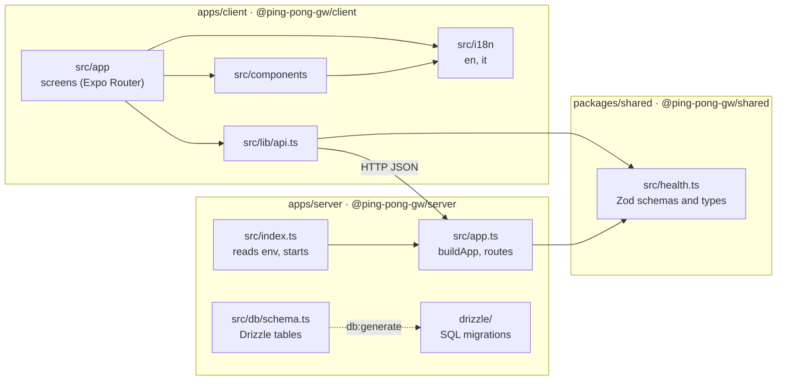
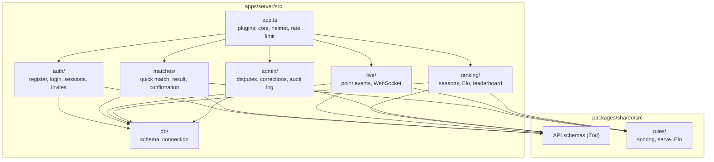
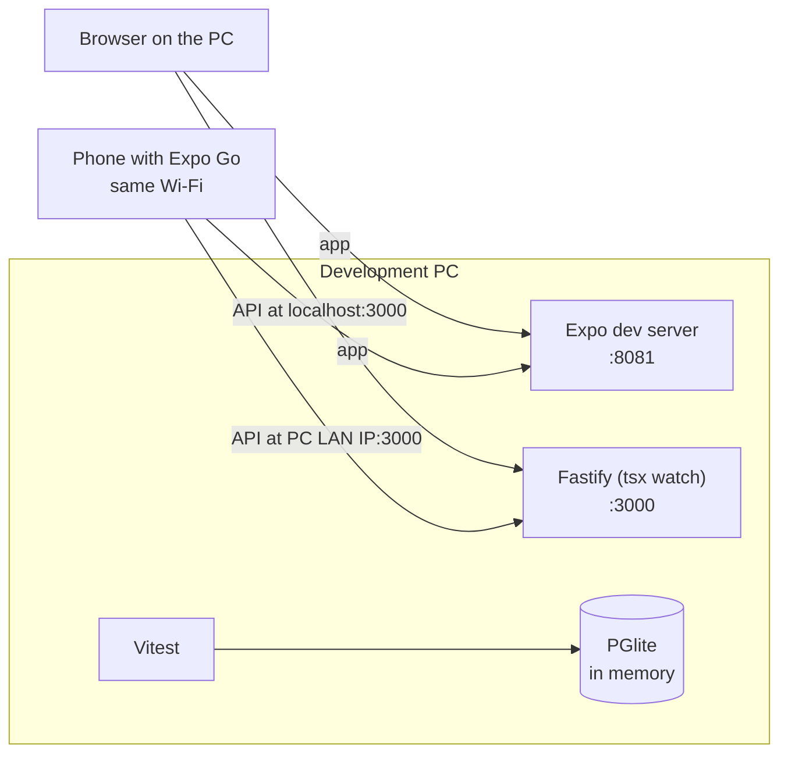
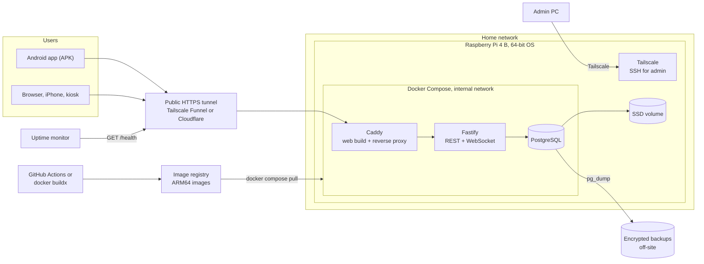

# Architecture

Each diagram is marked **implemented** (matches the code today) or **planned** (target design from [tech-stack.md](../tech-stack.md)
and [plan.md](../plan.md)). Planned diagrams are a guide and change when the design does.

## Packages and dependencies
Status: **implemented**.

The pnpm monorepo has three packages. Client and server depend on `shared`, never on each other.

| Package | Main libraries |
|---|---|
| `apps/client` | Expo, Expo Router, React Native, react-i18next, expo-localization |
| `apps/server` | Fastify, @fastify/cors, Drizzle ORM, pg; dev: drizzle-kit, PGlite, tsx, tsup |
| `packages/shared` | Zod |
| root | TypeScript, Vitest |

## Planned server modules
Status: **planned**, from Phase 2 onwards. The server is split by feature; each feature owns its routes and database access, and
the game rules stay in `shared` so the client can use them too.

## Development setup
Status: **implemented**. How the pieces run on the development PC.

- The client calls `EXPO_PUBLIC_API_URL` from `apps/client/.env`; the server accepts the origins in `CORS_ORIGIN` from
  `apps/server/.env`.
- The PC's LAN IP changes with the network, so both files must be updated after a network change.
- There is no PostgreSQL on the PC: tests apply the real migrations to PGlite.

## Deployment
Status: **planned** (Phase 1 and Phase 6). The public tunnel is still to be chosen: Tailscale Funnel is recommended, a Cloudflare
Tunnel is the alternative.

- No container publishes ports to the home network; the tunnel opens outbound.
- Tailscale runs on the host, outside Docker, so remote access survives a failure of the containers.
- Every user must be logged in, kiosk screens included.
