# Database

Status: **implemented**. Source of truth: [apps/server/src/db/schema.ts](../apps/server/src/db/schema.ts); migrations are in
[apps/server/drizzle](../apps/server/drizzle). Tournament tables are not modelled yet and come with Phase 5 of [plan.md](../plan.md).

## Entity-relationship diagram
Column names are the database names. Key markers: `PK` primary key, `FK` foreign key, `UK` unique. `timestamptz` is a timestamp
with time zone.

```mermaid
erDiagram
    users ||--o{ sessions : "logs in with"
    users ||--o{ league_members : "belongs to"
    leagues ||--o{ league_members : "has"
    leagues ||--o{ invites : "invites through"
    users ||--o{ invites : "creates"
    users |o--o{ invites : "redeems"
    leagues ||--o{ seasons : "runs"
    leagues ||--o{ play_days : "schedules"
    users ||--o{ play_days : "creates"
    leagues ||--o{ matches : "hosts"
    seasons ||--o{ matches : "groups"
    play_days |o--o{ matches : "groups"
    users ||--o{ matches : "creates"
    users |o--o{ matches : "referees"
    users |o--o{ matches : "confirms"
    matches ||--o{ match_players : "is played by"
    users ||--o{ match_players : "plays in"
    matches ||--o{ match_games : "is scored in"
    matches ||--o{ match_events : "records"
    users ||--o{ match_events : "scores"
    seasons ||--o{ season_ratings : "ranks"
    users ||--o{ season_ratings : "is rated in"
    matches ||--o{ rating_changes : "causes"
    users ||--o{ rating_changes : "receives"
    users |o--o{ audit_log : "performs"

    users {
        uuid id PK
        text email UK "null after anonymization"
        text display_name
        text password_hash "null after anonymization"
        boolean is_superuser "default false"
        language language "en or it, default en"
        timestamptz anonymized_at
        timestamptz created_at
    }
    sessions {
        uuid id PK
        text token_hash UK "hash of the session token"
        uuid user_id FK "deleted with the user"
        timestamptz expires_at
        timestamptz created_at
    }
    leagues {
        uuid id PK
        text name
        integer points_to_win "11 or 21, default 11"
        integer best_of "1, 3 or 5, default 1"
        timestamptz created_at
    }
    invites {
        uuid id PK
        text token_hash UK "hash of the invite token"
        uuid league_id FK
        uuid created_by FK
        timestamptz expires_at
        uuid used_by FK "null until used"
        timestamptz used_at
        timestamptz created_at
    }
    league_members {
        uuid league_id PK, FK
        uuid user_id PK, FK
        league_role role "player or admin, default player"
        timestamptz joined_at
    }
    seasons {
        uuid id PK
        uuid league_id FK "unique together with starts_on"
        text name
        date starts_on
        date ends_on "not before starts_on"
        timestamptz created_at
    }
    play_days {
        uuid id PK
        uuid league_id FK "unique together with played_on"
        date played_on
        uuid created_by FK
        timestamptz created_at
    }
    matches {
        uuid id PK
        uuid league_id FK
        uuid season_id FK
        uuid play_day_id FK "optional"
        match_type type "singles or doubles"
        match_status status "default scheduled"
        integer points_to_win "11 or 21"
        integer best_of "1, 3 or 5"
        uuid referee_id FK "null when self-scored"
        integer first_server_side "1 or 2"
        integer winner_side "1 or 2, required when completed"
        uuid created_by FK
        uuid confirmed_by FK
        timestamptz confirmed_at
        timestamptz started_at
        timestamptz ended_at
        timestamptz created_at
    }
    match_players {
        uuid match_id PK, FK "deleted with the match"
        uuid user_id PK, FK
        integer side "1 or 2"
        integer position "1 or 2, default 1"
    }
    match_games {
        uuid match_id PK, FK "deleted with the match"
        integer game_number PK "from 1"
        integer side1_score "0 or more"
        integer side2_score "0 or more"
    }
    match_events {
        uuid match_id PK, FK "deleted with the match"
        integer sequence PK
        match_event_type type "point or undo"
        integer side "set for a point, null for an undo"
        uuid actor_id FK
        timestamptz created_at
    }
    season_ratings {
        uuid season_id PK, FK
        uuid user_id PK, FK
        match_type match_type PK "singles or doubles"
        integer rating "default 1000"
        integer matches_played "default 0"
    }
    rating_changes {
        uuid match_id PK, FK "deleted with the match"
        uuid user_id PK, FK
        integer rating_before
        integer rating_after
    }
    audit_log {
        uuid id PK
        uuid actor_id FK "null for system actions"
        text action
        text entity_type
        text entity_id
        jsonb before
        jsonb after
        timestamptz created_at
    }
```

## Enums
| Enum | Values |
|---|---|
| `language` | `en`, `it` |
| `league_role` | `player`, `admin` |
| `match_type` | `singles`, `doubles` |
| `match_status` | `scheduled`, `live`, `awaiting_confirmation`, `disputed`, `completed`, `cancelled` (transitions in [domain.md](domain.md#match-lifecycle)) |
| `match_event_type` | `point`, `undo` |

## Design choices
- **Users are anonymized, never deleted.** Email and password hash become null and `anonymized_at` is set, so match history and
  ratings stay consistent.
- **No teams table.** A team exists only within a match: `match_players.side` (1 or 2) and `position` (1 or 2 in doubles) replace it.
- **Match format is copied to each match.** `points_to_win` and `best_of` on `matches` keep the format used, even if the league
  default changes later.
- **Live points are append-only.** An undo is a new `match_events` row; the score is rebuilt by replaying the events in `sequence`
  order.
- **`match_games` holds the score of every game**, both for live matches and for matches entered only as a final result.
- **One rating row per season, player and match type.** A new season starts from new rows at 1000, and past seasons stay archived.
- **Tokens are stored as hashes** (`sessions.token_hash`, `invites.token_hash`), so a database leak does not expose usable tokens.

## Delete rules
Only rows that make no sense on their own are deleted in cascade. Every other foreign key uses the default `no action`, so the
database refuses to delete a row that is still referenced.

| Foreign key | On delete |
|---|---|
| `sessions.user_id` | cascade |
| `match_players.match_id`, `match_games.match_id`, `match_events.match_id`, `rating_changes.match_id` | cascade |
| All others | no action |

## Constraints
Constraint names follow `<table>_<column>_check`. Tests in [schema.test.ts](../apps/server/src/db/schema.test.ts) read the name from
the error to prove which rule fired.

| Constraint | Rule |
|---|---|
| `leagues_points_to_win_check`, `matches_points_to_win_check` | points to win is 11 or 21 |
| `leagues_best_of_check`, `matches_best_of_check` | best of 1, 3 or 5 |
| `matches_first_server_side_check`, `matches_winner_side_check` | side is 1 or 2 |
| `matches_completed_has_winner_check` | a completed match has a winner |
| `seasons_dates_check` | `ends_on` is not before `starts_on` |
| `seasons_league_id_starts_on_unique` | one season per league and start date |
| `play_days_league_id_played_on_unique` | one play day per league and date |
| `match_players_side_check`, `match_players_position_check` | side and position are 1 or 2 |
| `match_players_match_side_position_unique` | one player per side and position |
| `match_games_game_number_check` | game numbers start at 1 |
| `match_games_scores_check` | scores are not negative |
| `match_events_side_check` | a point has side 1 or 2, an undo has no side |

## Indexes
| Index | Speeds up |
|---|---|
| `sessions_user_id_idx` | sessions of a user |
| `matches_season_id_idx` | matches of a season |
| `matches_status_idx` | live and pending matches |
| `match_players_user_id_idx` | match history of a player |
| `audit_log_entity_idx` | history of one entity |

## Changing the schema
1. Edit [schema.ts](../apps/server/src/db/schema.ts).
2. Run `corepack pnpm --filter @ping-pong-gw/server db:generate` to create the next numbered migration. Never edit a migration that
   has been applied to a real database.
3. Add or update tests in [schema.test.ts](../apps/server/src/db/schema.test.ts) for new defaults and constraints.
4. Update this document.
