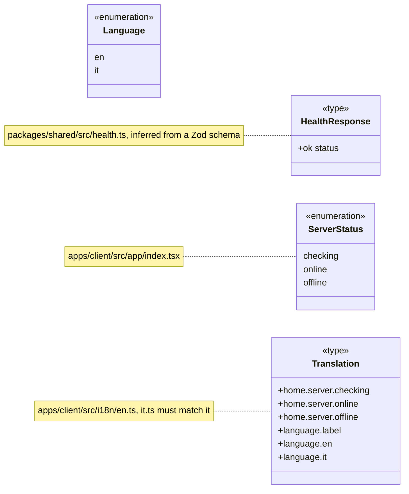
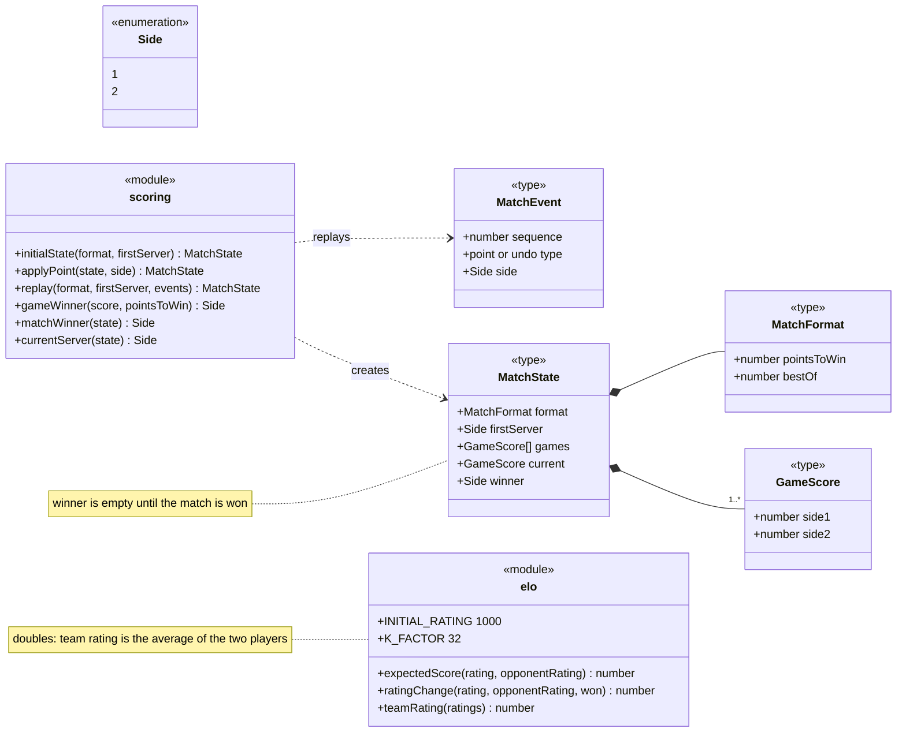
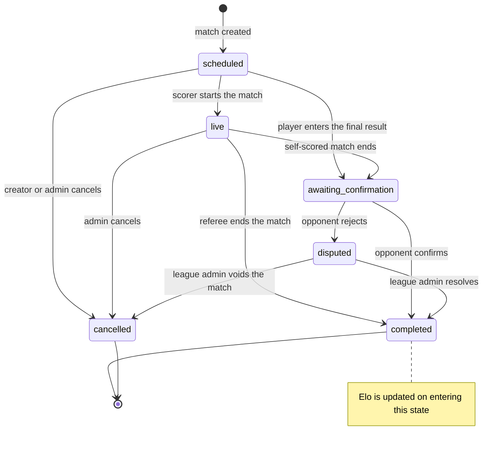

# Domain model

The rules come from [project-scope.md](../project-scope.md). The database side is in [database.md](database.md).

## Shared types today
Status: **implemented**. TypeScript has no classes in this project yet; these are the main types, shown as classes.

## Game rules
Status: **planned** for Phase 2, in `packages/shared/src/rules` so client and server use the same code. The rules are pure
functions, shown as modules; state objects are immutable and each function returns a new one.

| Rule | Detail |
|---|---|
| Game win | First side to `pointsToWin` with a lead of at least 2 points |
| Match win | First side to win more than half of `bestOf` games |
| Serve | Changes every 2 points; at deuce (both sides at `pointsToWin - 1` or more) it changes every point |
| Undo | An undo cancels the latest point not already cancelled; `replay` rebuilds the state from all events |
| Elo | Start at 1000, K = 32, reset each season; both doubles players get the team's change |

Open points for Phase 2:
- Serve rotation in 21-point games (the scope only fixes it for 11-point games; the traditional rule is every 5 points).
- Who serves first in later games, and the serve order between the four players in doubles.

## Match lifecycle
Status: the statuses are **implemented** in the `match_status` enum; the transitions are **planned** for Phases 3 and 4.

- A result entered by a referee is final; a result entered by a player needs the opponent's confirmation.
- A completed match must have `winner_side` (enforced by `matches_completed_has_winner_check`).
- Who can cancel a match, and when, is to be confirmed in Phase 3.
