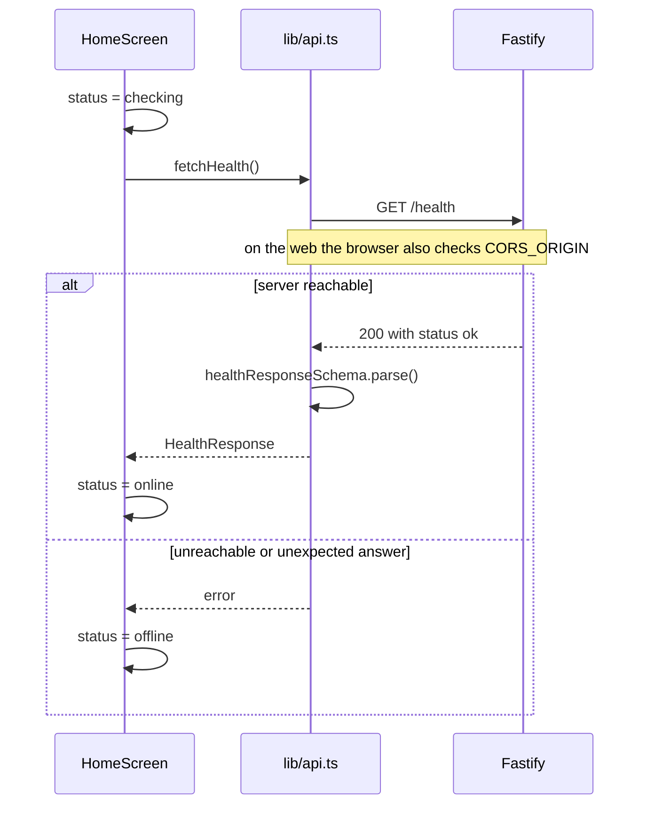
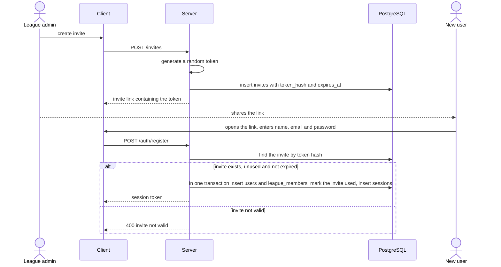
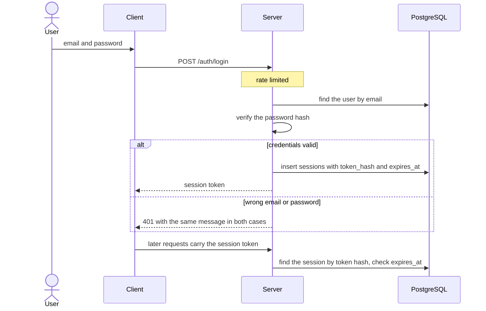
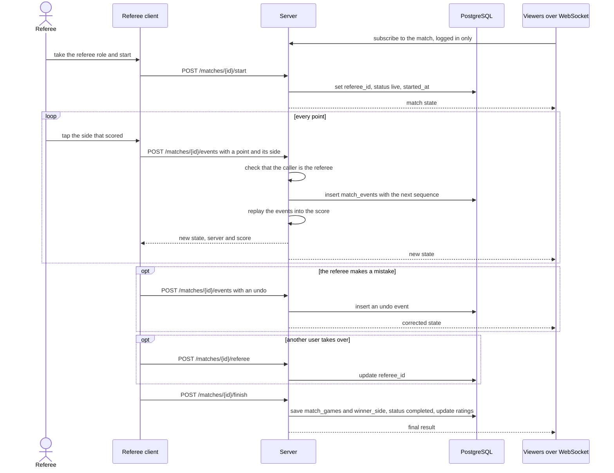
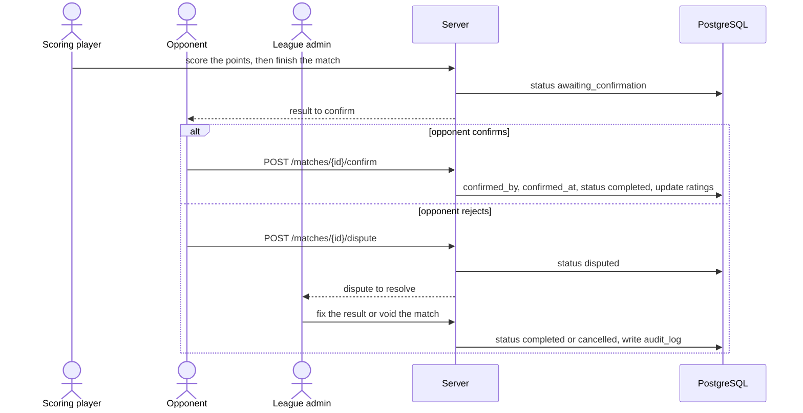
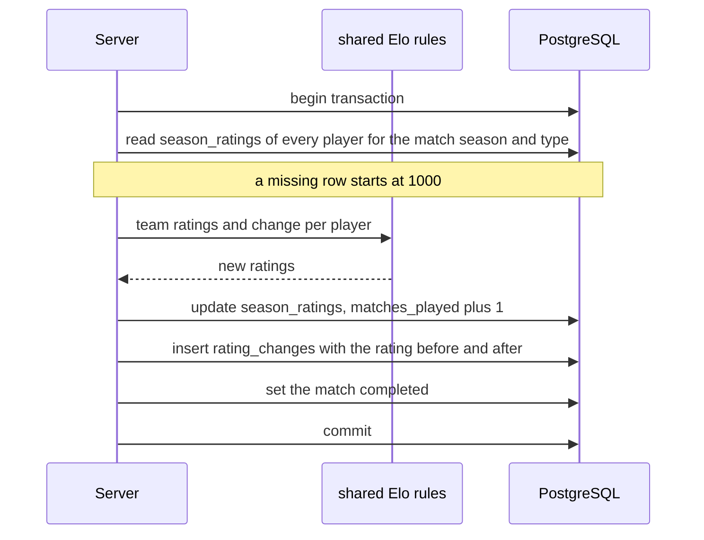
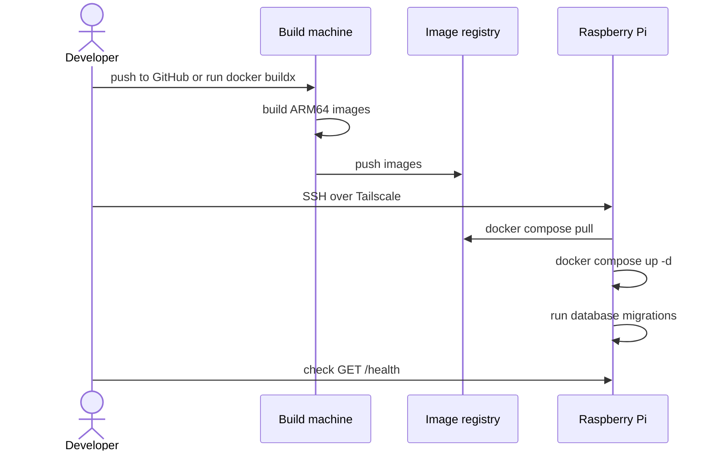

# Flows

Sequence diagrams of the main interactions. Each is marked **implemented** or **planned**. In planned flows the endpoint paths are
proposals, to be fixed when the feature is built.

## Server health check
Status: **implemented** in [index.tsx](../apps/client/src/app/index.tsx), [api.ts](../apps/client/src/lib/api.ts) and
[app.ts](../apps/server/src/app.ts).

## Invite and registration
Status: **planned** for Phase 2. Registration is possible only through an invite.

## Login
Status: **planned** for Phase 2. How the session token travels (cookie on the web, header in the app) is decided with this feature.

## Live match with a referee
Status: **planned** for Phase 4.

- `match_events` has the primary key `(match_id, sequence)`: if two devices send a point at the same moment, one insert fails and
  that client reloads the state.
- After a connection drop, clients reconnect and reload the full state before applying new updates.

## Self-scored match and confirmation
Status: **planned** for Phases 3 and 4. The same confirmation applies to a final result entered without live scoring.

## Rating update
Status: **planned** for Phase 3. Runs inside the transaction that marks a match completed.

- The season of a match is the calendar quarter it is played in. The season row is created automatically when the first match of
  the quarter needs it.

## Deployment
Status: **planned** for Phase 1.

